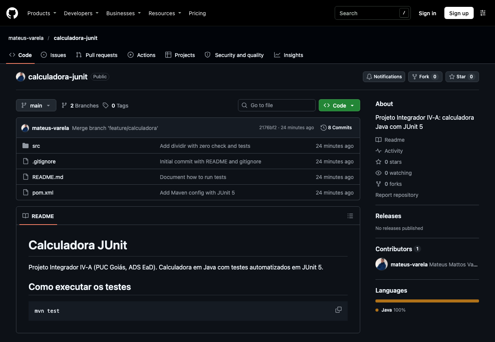
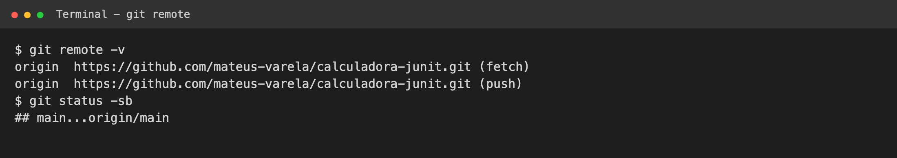
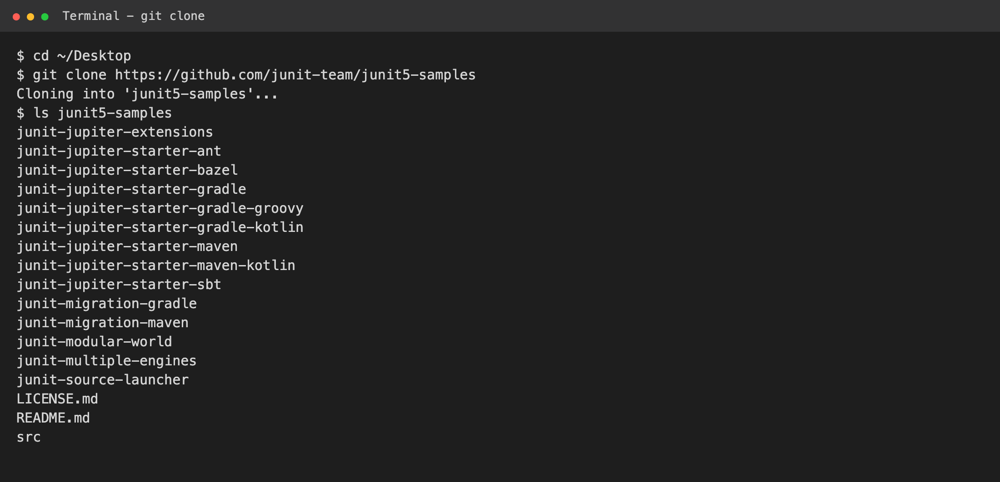
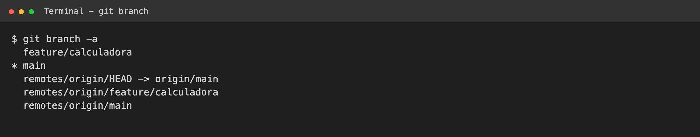
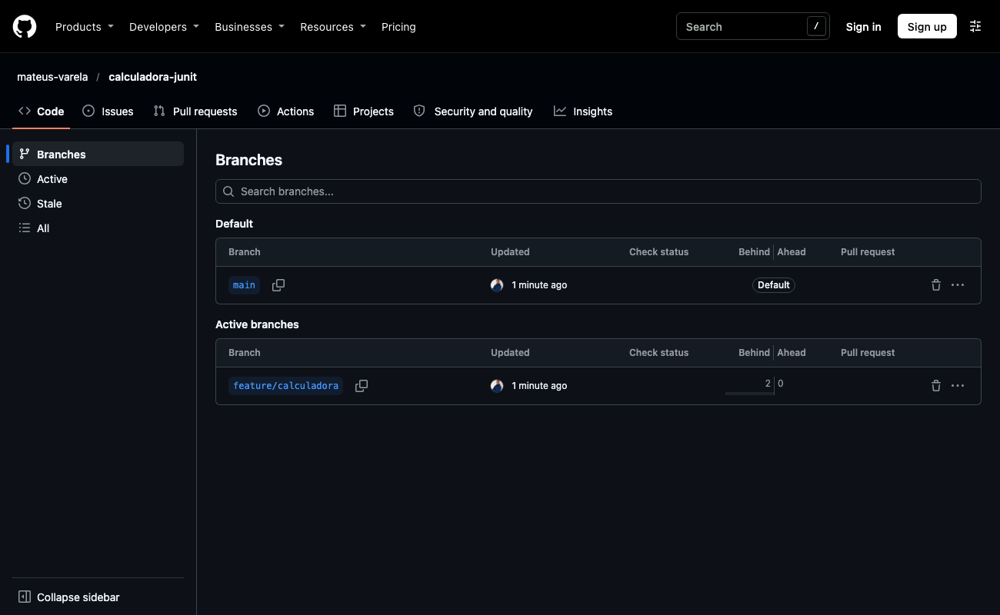
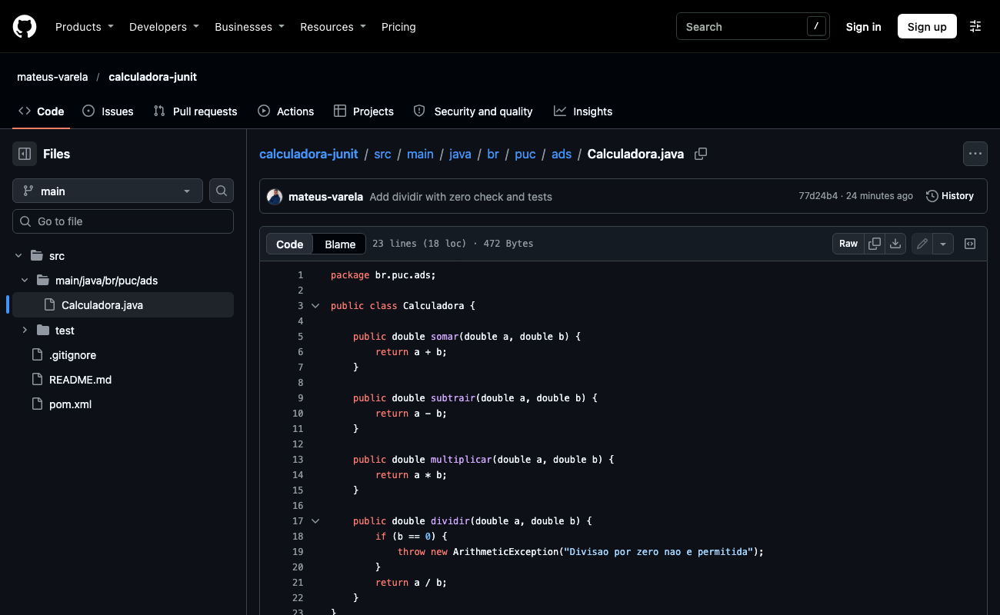
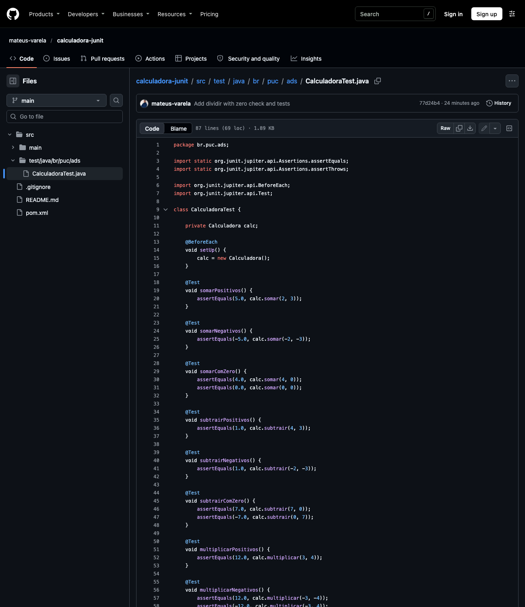
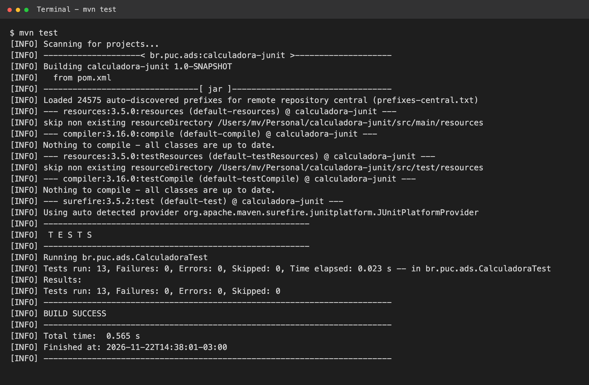
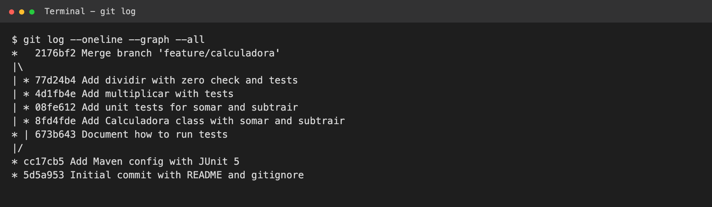
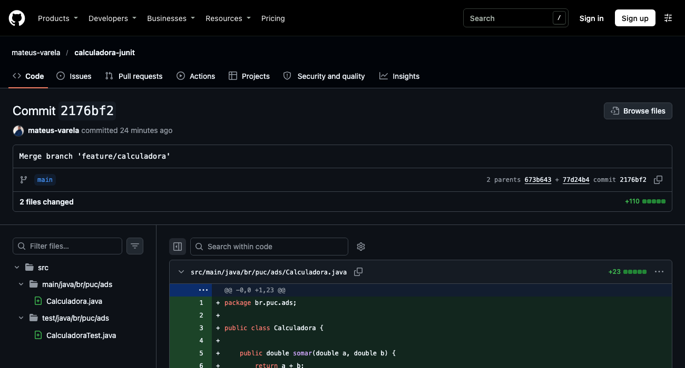

# Calculadora JUnit

**Projeto Integrador IV-A** - PUC Goiás - Análise e Desenvolvimento de Sistemas (EaD)
**Aluno:** Mateus Mattos Varela
**Repositório:** https://github.com/mateus-varela/calculadora-junit

Este projeto é uma calculadora em Java com testes automatizados em **JUnit 5**, versionada com **Git e GitHub** usando branch e merge. Este arquivo explica cada item pedido na atividade, na ordem em que aparece no vídeo de demonstração.

## Sumário

1. [Conta no GitHub](#1-criação-da-conta-no-github)
2. [Repositório](#2-criação-do-repositório)
3. [Clone de um repositório existente](#3-clone-de-um-repositório-existente)
4. [Branch da funcionalidade](#4-criação-da-branch)
5. [Classe Calculadora](#5-implementação-da-classe-calculadora)
6. [Classe de testes com JUnit 5](#6-implementação-da-classe-de-testes)
7. [Commits](#7-commits-do-código-fonte)
8. [Merge entre branches](#8-merge-entre-branches)
9. [Como executar](#como-executar-o-projeto)

---

## 1. Criação da conta no GitHub

O GitHub é a plataforma onde o código fica guardado na nuvem e a equipe colabora. A minha conta é **mateus-varela**.


## 2. Criação do repositório

Um repositório é a pasta do projeto com todo o histórico de alterações. Criei o `calculadora-junit` na minha conta e o enviei com `git push`.



O vínculo entre a pasta local e o repositório do GitHub (o `origin`):



## 3. Clone de um repositório existente

**Clonar** (`git clone`) é copiar um projeto que já está no GitHub para o meu computador, com todo o histórico. É o primeiro passo de quem entra numa equipe e precisa trabalhar no código que já existe.

Como exemplo, clonei o repositório de exemplos oficial do JUnit:

```
git clone https://github.com/junit-team/junit5-samples
```



Esse repositório é só uma demonstração do comando e não faz parte da calculadora.

## 4. Criação da branch

Uma **branch** (ramificação) é uma linha de desenvolvimento separada. Assim eu desenvolvo uma funcionalidade sem mexer na `main`, que fica estável. Criei a branch `feature/calculadora`:

```
git checkout -b feature/calculadora
```

No terminal:



No GitHub:



## 5. Implementação da classe Calculadora

A classe `Calculadora` fica em `src/main/java/br/puc/ads/Calculadora.java` e tem as quatro operações: `somar`, `subtrair`, `multiplicar` e `dividir`.

Na divisão, se o divisor for zero o método lança uma `ArithmeticException`, em vez de devolver um resultado inválido.



## 6. Implementação da classe de testes

A classe `CalculadoraTest` fica em `src/test/java/br/puc/ads/CalculadoraTest.java` e usa o **JUnit 5** (dependência `junit-jupiter` no `pom.xml`).

- Cada método com `@Test` é um cenário de teste.
- O `@BeforeEach` cria uma nova `Calculadora` antes de cada teste, para que um teste não influencie o outro.
- Os testes cobrem números positivos, negativos e zero em todas as operações.
- Na divisão por zero, o `assertThrows` confirma que a exceção é lançada e confere a mensagem.

São 13 testes no total, todos passando.



Execução com `mvn test`:



## 7. Commits do código-fonte

Um **commit** é um ponto salvo do histórico, com uma mensagem dizendo o que mudou. Fiz um commit por etapa: configuração, soma e subtração, testes, multiplicação e divisão.




## 8. Merge entre branches

O **merge** junta o trabalho de uma branch em outra. Quando terminei a funcionalidade, voltei para a `main` e juntei a `feature/calculadora`:

```
git checkout main
git merge --no-ff feature/calculadora
```

Enquanto a feature era desenvolvida, a `main` também recebeu um commit (a documentação de como rodar os testes). Por isso o Git criou um **commit de merge**, com dois pais, juntando as duas linhas de histórico. No gráfico do terminal, é o ponto onde as duas linhas se encontram (`Merge branch 'feature/calculadora'`).


O commit de merge no GitHub, com os dois pais (`2 parents`):



---

## Como executar o projeto

Requisitos: Java 17 ou superior e Maven.

```
git clone https://github.com/mateus-varela/calculadora-junit
cd calculadora-junit
mvn test
```

## Estrutura

```
calculadora-junit/
├── pom.xml
├── README.md
├── docs/img/                 prints usados neste arquivo
└── src/
    ├── main/java/br/puc/ads/Calculadora.java
    └── test/java/br/puc/ads/CalculadoraTest.java
```
